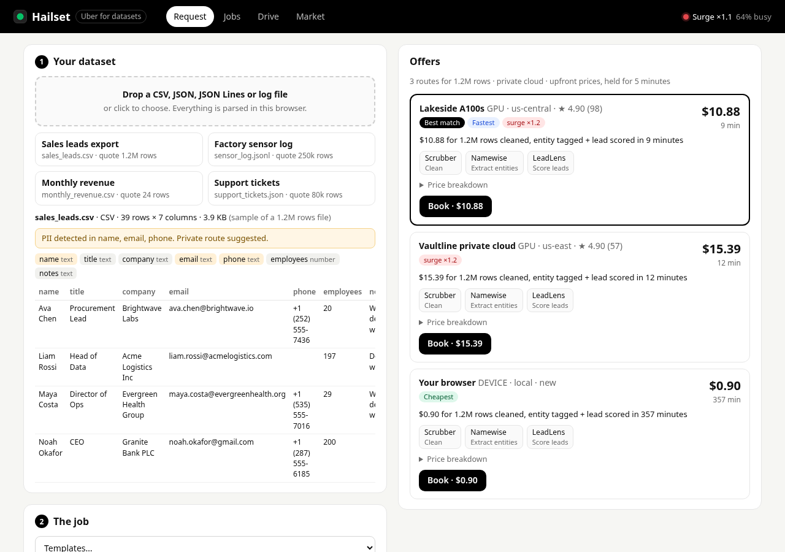
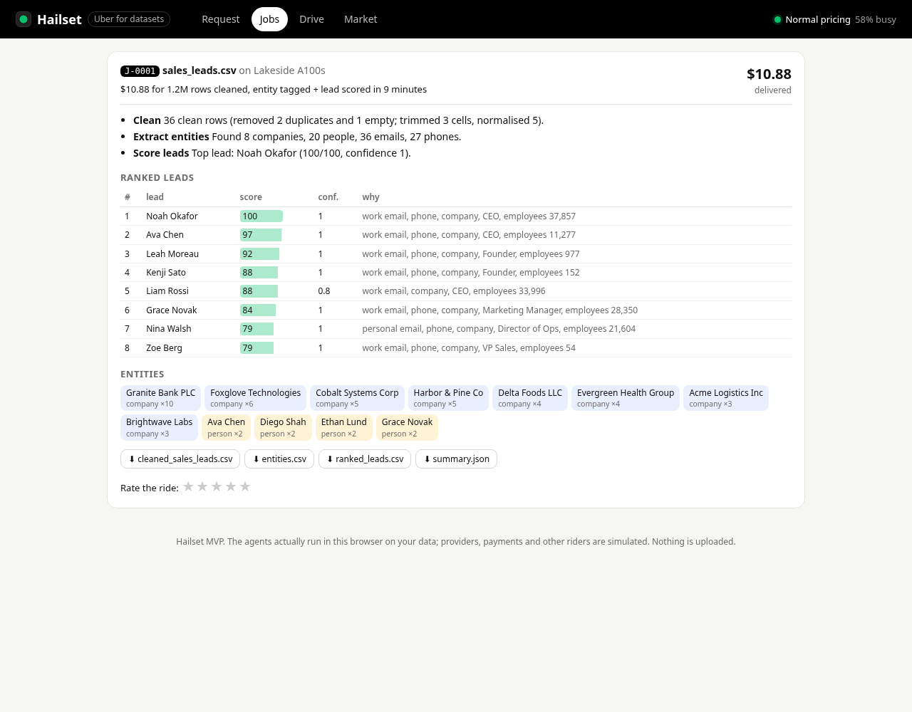
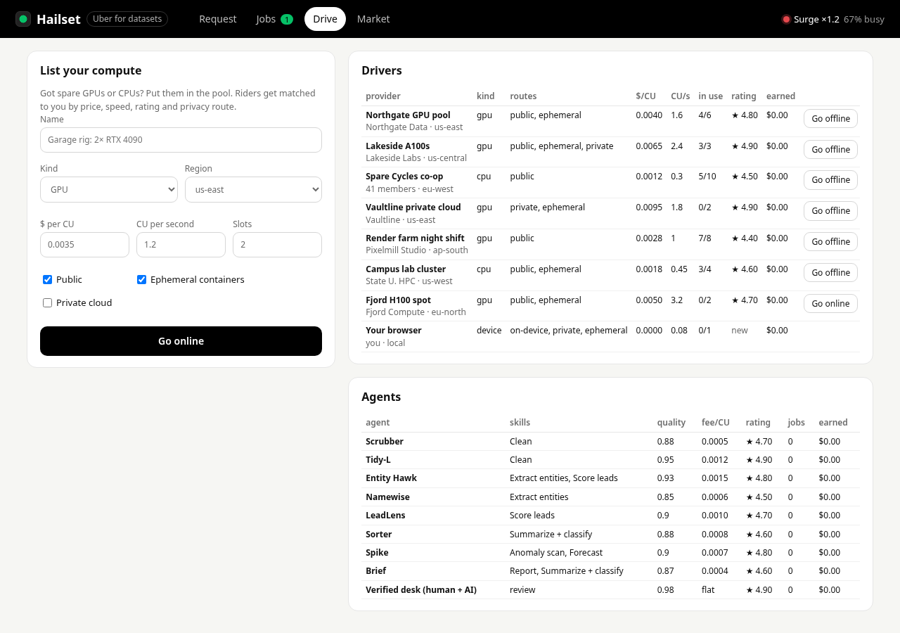

# Hailset: Uber for datasets

**Live:** https://fitzyracing1.github.io/uber-for-datasets/ · **Repo:** https://github.com/fitzyracing1/uber-for-datasets



You have data and a job. Other people have spare compute. Hailset connects the two, Uber-style.

1. **Drop a dataset** (CSV, TSV, JSON, JSON Lines or a plain log). It is parsed and profiled in your browser,
   and PII columns (emails, phones, names) are flagged.
2. **Describe the job in plain words.** For example: *"Clean this sales data, extract every company and person,
   score lead quality, and give me a ranked list with confidence."* That becomes job types (clean, extract
   entities, score leads, summarize + classify, anomaly scan, forecast, report) plus hints like speed, privacy,
   human review, or "under $20".
3. **Set constraints.** A slider from cheapest to fastest, a privacy route (any, ephemeral container, private
   cloud, or on-device), an optional price cap and deadline, and an optional verified human-review tier.
4. **Get upfront offers.** Each offer pairs a compute provider with an agent stack and shows the price, the ETA,
   and a full breakdown. Offers are tagged *Best match*, *Cheapest* and *Fastest*. Surge applies when the pool is busy.
5. **Book it and track it.** You see a live progress bar and stage. On delivery you get results you can download
   (cleaned CSV, entities.csv, ranked_leads.csv, anomalies.csv, report.md, summary.json), and you can rate the ride.
6. **Drive.** Add your own GPU or CPU capacity to the pool, then watch it get matched and earn money.

The agents are real. Clean, extract, score, classify, anomaly scan, forecast and report all run on your rows in
the browser, using deterministic heuristics with no model API. The providers, other riders, payments and the
clock are simulated, and time runs 60× faster (1 s = 1 min). Nothing is uploaded anywhere.

| | |
|---|---|
|  |  |

## Run it

It is a static site with no build step and no dependencies.

```sh
npm start            # python3 -m http.server 8080, then open http://localhost:8080
```

Deep links for demos: `?sample=0..3`, `&find=1` (match right away), `&book=1` (book the best offer),
`&deliver=1` (skip to delivery), and `#request|trips|drive|market`. Example:
`/?sample=0&book=1&deliver=1`.

The repo also deploys to GitHub Pages as-is (`.github/workflows/pages.yml`).

## How the marketplace works

- **Compute units (CU).** 1 CU is about one GPU-second on a reference card. Each job type costs a base amount
  plus CU per 1,000 rows, scaled by column count (`src/market.js`, `JOB_TYPES`). CPU pools pay 1.5× on GPU-heavy work.
- **Price.** (compute + agent fees + human review) × surge, plus a 10% platform fee. Minimum fare is $0.50.
  The chat's example, "$4.20 for 1.2M rows cleaned + entity tagged in 9 minutes", prices out at about
  that on the seeded Northgate pool, and a test checks it.
- **Surge.** Starts above 60% pool utilisation: ×(1 + 2.5 × (busy − 0.6)), capped at ×2.5. Ambient demand from
  other riders moves in a deterministic wave per provider, and the Market tab has a *Rush hour* toggle.
  The on-device route never surges.
- **Matching.** Privacy routes, free slots, the price cap and the deadline are hard filters. The remaining offers
  are ranked by normalised price and ETA weighted by the slider, then nudged by rating and preferred providers.
  For each job type the agent stack picks the agent that trades quality against fee according to the slider.
- **Lifecycle.** Booking holds a slot. When the ETA passes, the job is delivered, the slot is freed, and the
  provider is paid compute × surge while agents get their fees × surge. Cancelling refunds the job.
  Ratings are running averages, one per job.
- **Templates.** Save a job as a one-tap template. Two come seeded, including "Monthly sales lead scoring".

State (the market, jobs and results) lives in `localStorage`. *Reset demo* on the Market tab clears it.

## Layout

```
index.html          the app (Request / Jobs / Drive / Market)
src/data.js         CSV/JSON/JSONL/text parsing, profiling, PII detection
src/agents.js       clean, extract, score, classify, anomaly, forecast, report, runPipeline
src/market.js       taxonomy, intent parsing, work units, surge, quotes, matching, lifecycle, ratings
src/seed.js         seeded providers, agents, templates and four sample datasets
src/app.js          UI
src/style.css
test/               node --test suites (data, agents, market)
```

## Tests

```sh
npm test             # node --test test/*.test.js (Node 18+)
```

There are 24 tests: the parsers and profiling, every agent on the seeded samples (the injected sensor spikes are
found, the forecast slope and labels are right, leads rank correctly), intent parsing, pricing against the chat's
example, surge, slider ranking, privacy filters, caps and deadlines, human review, minimum fare, the full
book → deliver → pay → rate lifecycle, cancel and refund, drivers adding capacity, and JSON-serialisable state.
CI runs them on Node 18, 20 and 22.

## Origin

Built from the Grok chat "Uber for Datasets Marketplace" (https://grok.com/c/631dda50-1db5-4c80-895f-9d093fd79f06,
Aug 13, 2026). That chat was only a product plan. This repo is the MVP it described: rider and driver sides,
dynamic pricing with surge, ratings, privacy routes, a verified human tier, templates, a transparent breakdown,
and the four starter job families.

Not included, by design: real payments (Stripe), real remote compute, accounts, and LLM-backed agents. The agent
interface (`runPipeline`) is where a model-backed agent would plug in.

## License

MIT

## Plans

This project is free, and its license stays as is. Support it through [GitHub Sponsors](https://github.com/sponsors/fitzyracing1):

- **Free**: use the code, community support.
- **Pro ($49/month)**: priority issues and support.
- **Team ($199/month)**: priority support for your team plus early access.
